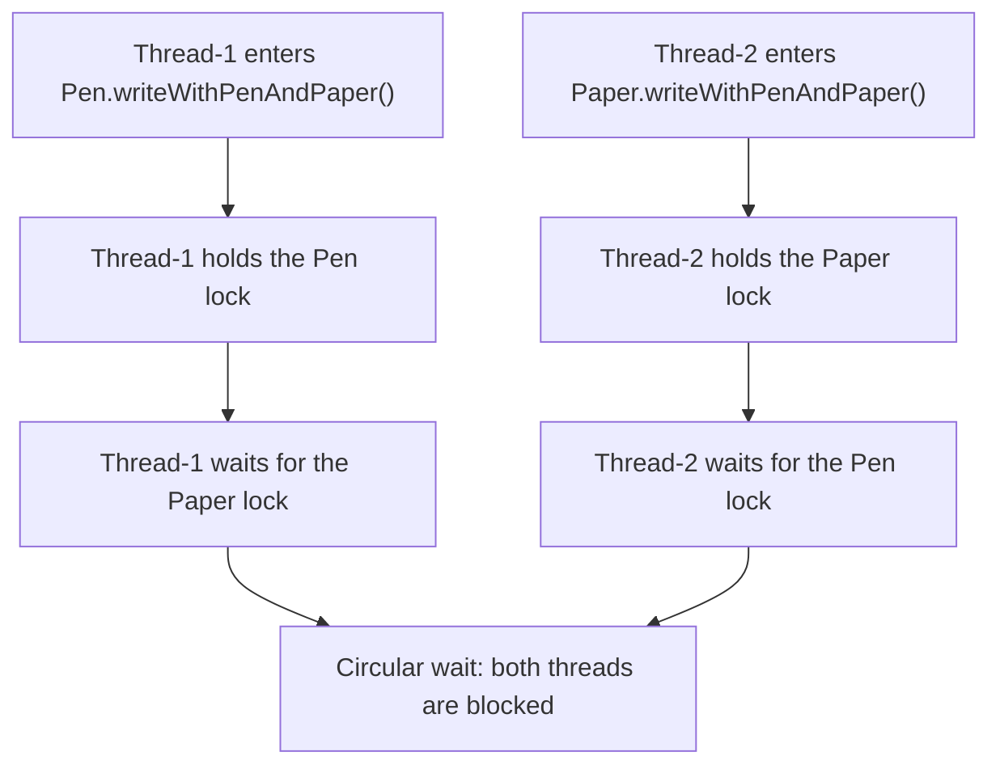

<div align="center">

# 🔒 Java Deadlock Implementation

**Transactions are permanently blocked because each process holds a resource and waits for another resource held by another process in the set, creating a circular standstill.**


</div>

## 📌 Overview

This project demonstrates how a **deadlock** can occur when multiple threads acquire locks on shared objects in different orders.

The example models two resources:

- ✒️ `Pen`
- 📄 `Paper`

Two threads attempt to use both resources. Each resource exposes synchronized methods, so a thread acquires that object's monitor before entering the method. If one thread holds the pen lock while waiting for the paper lock, and another holds the paper lock while waiting for the pen lock, neither thread can proceed.

> **Note:** Deadlock reproduction depends on thread scheduling. Because this example does not force a specific interleaving, it may not deadlock on every run.

## 🧠 How the Deadlock Happens



The potential circular wait is:

| Thread | Holds | Waits for |
|---|---|---|
| `Thread-1` | `Pen` | `Paper` |
| `Thread-2` | `Paper` | `Pen` |

This illustrates the core deadlock idea: each thread holds a resource that the other thread needs.

## 🗂️ Project Structure

```text
Java-Deadlock-Implementation/
├── DeadLockExample.java
├── CoreClasses/
│   ├── Pen.java
│   └── Paper.java
└── Task/
    ├── Task1.java
    └── Task2.java
```

### File responsibilities

- **`DeadLockExample.java`** — Creates the shared `Pen` and `Paper` objects, creates two threads, and starts them.
- **`CoreClasses/Pen.java`** — Defines synchronized methods for writing with a pen and finishing writing.
- **`CoreClasses/Paper.java`** — Defines synchronized methods for writing with paper and finishing writing.
- **`Task/Task1.java`** — Runnable task that starts by acquiring the pen lock.
- **`Task/Task2.java`** — Runnable task that starts by acquiring the paper lock.

## ⚙️ Requirements

- Java Development Kit (JDK) installed
- Terminal or IDE such as IntelliJ IDEA, Eclipse, or VS Code with Java support

Check your Java installation:

```bash
java -version
javac -version
```

## ▶️ Run the Project

Run these commands from the project root, where `DeadLockExample.java` is located.

### 1. Compile

```bash
javac DeadLockExample.java CoreClasses/*.java Task/*.java
```

### 2. Execute

```bash
java DeadLockExample
```

The output depends on thread scheduling. You may see messages indicating that a thread acquired a lock and is trying to use the other resource. If a deadlock occurs, the program may stop making progress while the Java process remains running.

To stop a run that is stuck, press `Ctrl + C` in the terminal.

## 🛠️ Preventing Deadlock

A common prevention technique is to **enforce a consistent lock-acquisition order** across all threads. For example, ensure that every task acquires the `Paper` lock before the `Pen` lock, rather than allowing one task to acquire `Pen` first and the other to acquire `Paper` first.

The `Task1.java` file contains a commented synchronization block that suggests this approach. Any change should ensure that all code paths acquire shared locks in the same order.

Other strategies include:

- Avoid holding one lock while waiting to acquire another when possible.
- Use `tryLock()` with a timeout when using `ReentrantLock`.
- Keep synchronized critical sections short.
- Review thread interactions for circular-wait conditions.

## 🎯 Concepts Demonstrated

- Java multithreading with `Thread` and `Runnable`
- Intrinsic locks and `synchronized` methods
- Shared mutable resources
- Lock acquisition and circular wait
- Deadlock prevention through consistent lock ordering

## 📚 Learning Outcome

By exploring this project, you can observe how synchronized methods protect shared objects—and how inconsistent lock ordering can cause threads to block indefinitely.

---

<div align="center">

**Built to learn Java concurrency, one lock at a time.** 

</div>
